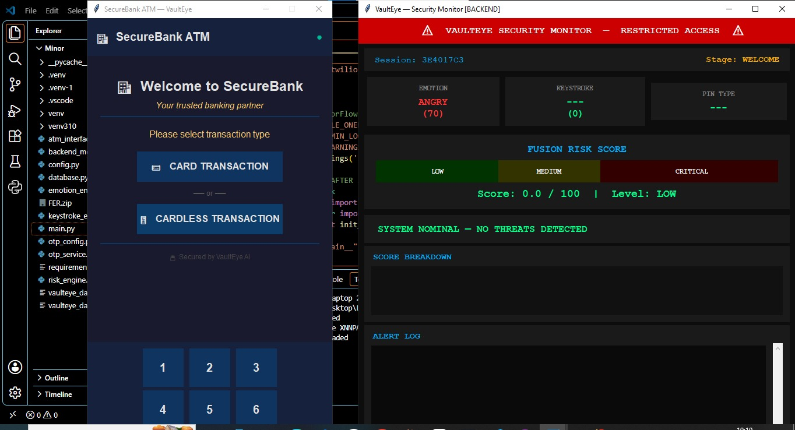
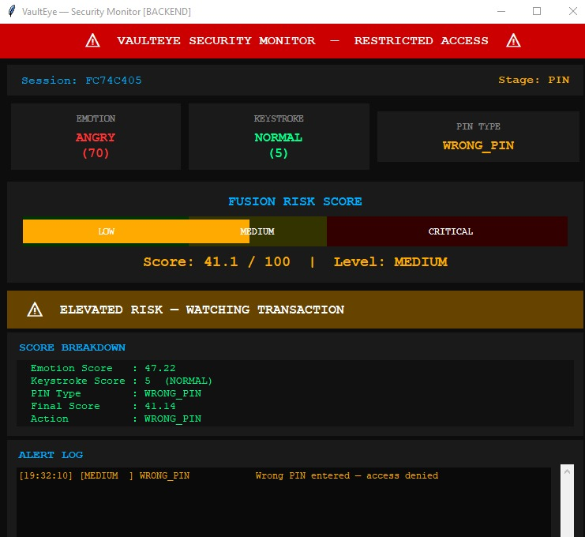
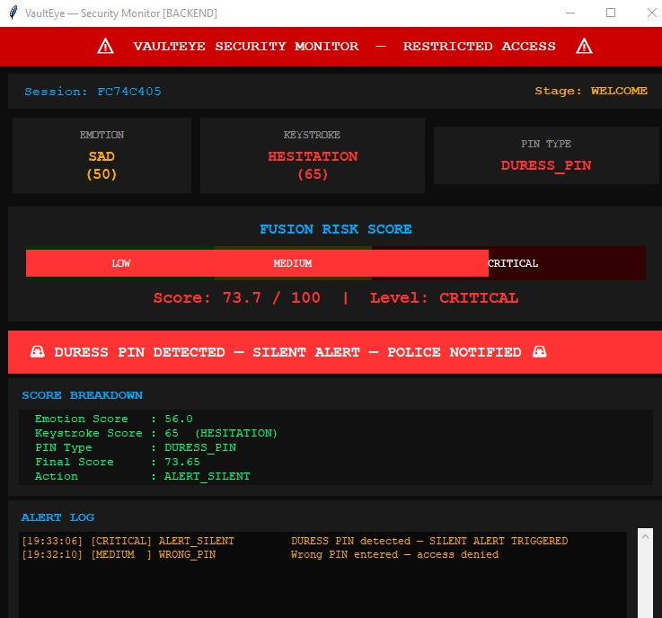
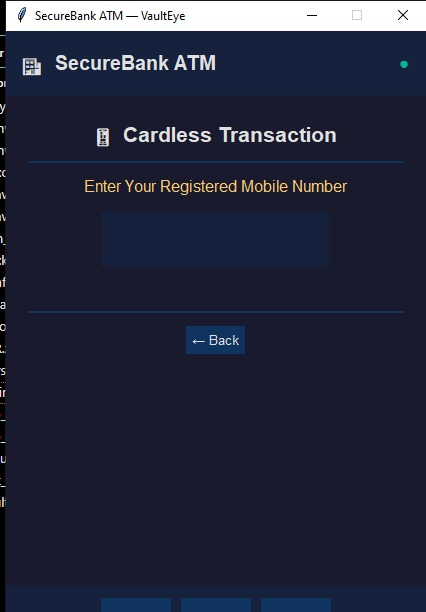
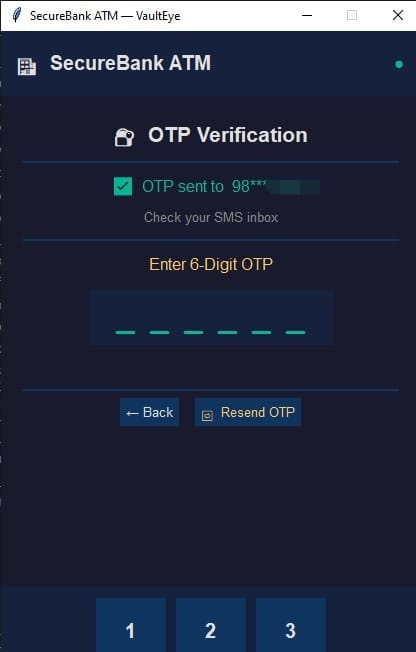

# VaultEye
### AI-Powered ATM Fraud Detection and Security Intelligence System
An academic project developed during the 6th semester of B.Tech Computer Science and Engineering, during January–June 2026.

---
## Project Overview

VaultEye is an AI-powered ATM Fraud Detection and Security Intelligence System developed as an academic project. It explores how multiple security indicators can be combined to identify potentially suspicious ATM transactions and respond to possible fraud or coercion scenarios.

Unlike a system that relies only on PIN authentication, VaultEye combines facial emotion analysis, keystroke behaviour monitoring, and PIN-related security signals to assess transaction risk. The system is designed with two separate components: an ATM interface for user interaction and a backend monitoring interface for security supervision.

When suspicious behaviour is detected, the backend can display security alerts and risk information. In a critical-risk scenario, the system is designed to restrict the transaction and use a discreet user-facing response, such as displaying a cash-unavailable message, while the backend handles the security alert. This approach aims to reduce the chance of escalating a potentially dangerous situation.

VaultEye is a software prototype developed for educational and demonstration purposes. Its emotion and behaviour indicators are experimental risk signals and cannot independently prove fraud or determine a person's intentions.

For demonstration purposes, the current minor-project version displays the ATM interface and backend monitoring interface side by side in a single window, while keeping their functionality organised into separate modules. The project is being extended in the major-project version to demonstrate the ATM interface on one laptop and the backend monitoring interface on another, providing a clearer representation of their separation.

The minor-project version supports cardless ATM transactions. Although card-based transaction functionality is part of the broader project development, support for both card-based and cardless transactions is being incorporated into the major-project version.

## How VaultEye Works

VaultEye combines multiple security-related inputs to assess the risk associated with an ATM session.

### 1. Data Collection and Monitoring

During an ATM session, the system processes relevant information from the simulated transaction workflow, including:

* **PIN-related signals:** Processes PIN input and the normal or duress-related PIN handling supported by the minor-project implementation.
* **Facial emotion indicators:** Webcam frames are analysed by the emotion recognition component to obtain emotion-related signals.
* **Keystroke behaviour:** The keystroke monitoring component analyses input-related behaviour for potentially unusual patterns.
* **Session and transaction information:** Relevant session events and configured risk indicators are used by the risk assessment component.

### 2. Risk Assessment

The collected signals are processed by the system's risk assessment logic. Configured weights, thresholds, and other security indicators contribute to the assessment.

The resulting risk level helps determine whether the session can continue normally or whether additional security actions should be triggered.

### 3. Backend Monitoring and Alerts

The backend monitoring interface displays relevant security information and alerts. This allows the monitoring component to present potential threats separately from the ATM interface used by the customer.

### 4. Response to Critical Risk

When the configured critical-risk conditions are met, the system is designed to restrict the transaction and trigger the corresponding backend security response. The ATM interface can display a discreet message, such as cash being unavailable, instead of directly revealing a suspected security event.

The intention is to prevent a potentially unsafe transaction from proceeding while avoiding unnecessary escalation at the ATM.

### 5. System Separation

The ATM interface and backend monitoring interface run as separate components. This design separates the customer-facing transaction workflow from security monitoring and helps demonstrate a modular system architecture.

## Screenshots and Demonstration

The following screenshots demonstrate the ATM interface, backend security monitoring, and selected authentication and risk-alert scenarios implemented in the VaultEye minor-project prototype.

### ATM and Backend Overview

The ATM interface and backend monitoring interface are displayed side by side for demonstration purposes in the minor-project version.



### Backend Risk Monitoring

The backend displays session information, facial emotion indicators, keystroke behaviour, PIN type, a combined risk score, and security-related events.



### Duress PIN Alert

This screenshot demonstrates the backend's response to a duress-PIN scenario, including a critical-risk indication and a silent-alert status.



### ATM-Side Security Response

The ATM interface displays a cash-dispenser-unavailable message during the demonstrated security-response scenario.


### Cardless Authentication

The cardless transaction workflow includes registered mobile number entry and OTP verification.






## Project Objectives
1. To develop a backend monitoring system for real time evaluation
2. To design a risk scoring model and silent alert generation
3. To implement a dual system architecture for ATM operation with hidden security and alerts

## Key Features

* **ATM Simulation:** Provides a graphical interface for interacting with a simulated ATM system.
* **Cardless ATM Transactions:** Supports the cardless transaction workflow implemented in the minor-project version.
* **Facial Emotion Analysis:** Uses webcam input and an emotion analysis component to extract facial emotion indicators.
* **Keystroke Behaviour Monitoring:** Analyses keystroke-related behaviour as an additional security signal.
* **Risk Assessment:** Combines configured risk indicators to assess potentially suspicious activity.
* **Backend Monitoring:** Displays security-related information and monitoring alerts through a separate interface.
* **OTP Verification:** Includes an OTP-based verification component for authentication workflows.
* **Database Support:** Uses SQLite to store project data, including session and security-related records.

## Technology Stack

The project uses the following technologies and libraries:

* **Programming Language:** Python
* **Graphical User Interface:** Tkinter
* **Computer Vision:** OpenCV
* **Facial Emotion Analysis:** FER (Facial Expression Recognition)
* **Database:** SQLite
* **OTP Service:** Twilio
* **Supporting Libraries:** NumPy and other dependencies listed in `requirements.txt`

## Project Architecture

VaultEye follows a modular structure in which different components handle ATM interaction, backend monitoring, emotion analysis, keystroke monitoring, risk assessment, and database operations.

The ATM interface and backend monitoring interface are designed to operate as separate components. This separation helps demonstrate how user-facing operations and security monitoring can be organised independently.

## Project Structure

```text
VaultEye_minor_project/
├── main.py
├── atm_interface.py
├── backend_monitor.py
├── config.py
├── database.py
├── emotion_engine.py
├── keystroke_engine.py
├── risk_engine.py
├── otp_config.py
├── otp_service.py
├── requirements.txt
├── .gitignore
└── README.md
```

### File Descriptions

| File                  | Purpose                                                     |
| --------------------- | ----------------------------------------------------------- |
| `main.py`             | Entry point for launching the application.                  |
| `atm_interface.py`    | Implements the ATM user interface and transaction workflow. |
| `backend_monitor.py`  | Provides the backend monitoring interface.                  |
| `config.py`           | Stores application settings and configurable parameters.    |
| `database.py`         | Manages SQLite database operations.                         |
| `emotion_engine.py`   | Handles webcam-based facial emotion analysis.               |
| `keystroke_engine.py` | Handles keystroke behaviour monitoring.                     |
| `risk_engine.py`      | Calculates risk based on configured indicators.             |
| `otp_config.py`       | Stores OTP provider configuration.                          |
| `otp_service.py`      | Handles OTP service integration.                            |
| `requirements.txt`    | Lists Python package dependencies.                          |
| `.gitignore`          | Excludes specified files and folders from Git tracking.     |
| `README.md`           | Documents the project and setup instructions.               |

## Installation and Setup

Follow these steps to set up VaultEye on your local computer.

### Prerequisites

* Python installed on your computer.
* Git, if you want to clone the repository.
* A webcam for the facial emotion analysis component.
* An internet connection for installing dependencies and using an externally hosted OTP service.
* Valid OTP service credentials if you want to enable real OTP delivery.

### 1. Clone the Repository

```bash
git clone https://github.com/tanisha3725/VaultEye_minor_project.git
cd VaultEye_minor_project
```

Alternatively, download the repository as a ZIP file from GitHub and extract it.

### 2. Create a Virtual Environment

On Windows:

```bash
python -m venv .venv
.venv\Scripts\activate
```

### 3. Install Dependencies

```bash
python -m pip install --upgrade pip
pip install -r requirements.txt
```

### 4. Configure OTP Credentials

The public repository does not contain real OTP service credentials. Configure your own credentials locally according to the OTP provider setup required by the application.

Never publish API keys, authentication tokens, or private credentials in the repository.

### 5. Run the Application

After installing dependencies and completing the required configuration, launch the application using:

```bash
python main.py
```

Follow the on-screen instructions to interact with the simulated ATM and monitoring interfaces.

## Security, Limitations, and Responsible Use

* VaultEye is an academic prototype intended for learning and demonstration.
* Facial emotion analysis is experimental and cannot reliably establish a person's intent or prove fraudulent behaviour.
* Risk scores and alerts should be interpreted as indicators for further review, not definitive fraud decisions.
* Real OTP delivery requires valid provider credentials and appropriate service configuration.
* Do not use real banking credentials, real customer information, or sensitive personal data when demonstrating the project.
* The prototype has not been established as a production-ready banking security system.

## Academic Information

* **Project Name:** VaultEye – AI-Powered ATM Fraud Detection and Security Intelligence System
* **Project Type:** Minor Project
* **Programme:** B.Tech in Computer Science and Engineering
* **Semester:** 6th Semester
* **Project Period:** January–June 2026
* **Project Nature:** Academic team project
* **College Name:** Guru Nanak Dev Engineering College, Ludhiana. 

## Future Scope

Potential future improvements include expanding security monitoring, refining risk assessment, improving authentication workflows, and evaluating the system with more comprehensive testing.

## Disclaimer

This project was developed for academic and educational purposes. It is a simulated system and is not affiliated with or endorsed by any bank or financial institution.
